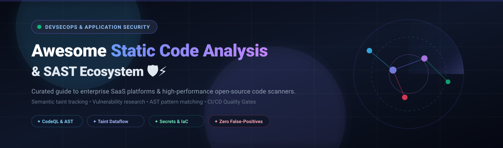
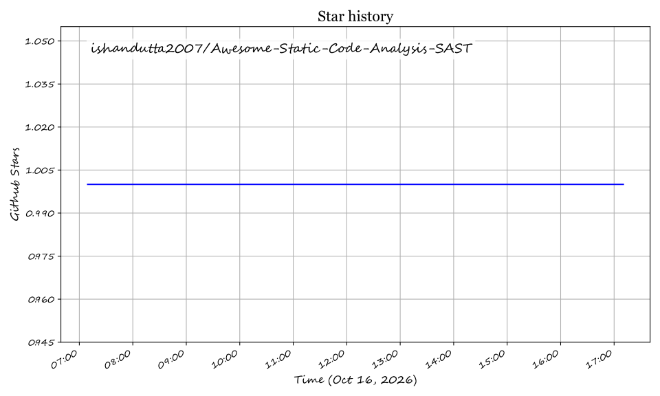

<div align="center">
  
</div>

<p align="center">
  <a href="https://github.com/ishandutta2007/Awesome-Awesome-Awesome"></a>
  <a href="https://discord.gg/jc4xtF58Ve"></a>
  <a href="https://github.com/ishandutta2007/Awesome-Static-Code-Analysis-SAST/stargazers"></a>
  <a href="https://github.com/ishandutta2007/Awesome-Static-Code-Analysis-SAST/network/members"></a>
  <a href="https://github.com/ishandutta2007/Awesome-Static-Code-Analysis-SAST/pulls"></a>
  <a href="https://github.com/ishandutta2007/Awesome-Static-Code-Analysis-SAST/blob/main/LICENSE"></a>
  <a href="https://github.com/ishandutta2007"></a>
</p>

---

# 🛡️ Awesome Static Code Analysis & SAST Tools

> **A curated index of enterprise SaaS platforms and leading open-source GitHub projects for Static Application Security Testing (SAST), semantic taint analysis, automated quality gates, and DevSecOps CI/CD security integration.**

Static Application Security Testing (**SAST**) scrutinizes source code, byte code, and compiled binaries in a non-runtime state to uncover high-impact vulnerabilities—including SQL/Command Injection (CWE-89, CWE-78), Cross-Site Scripting (XSS, CWE-79), Server-Side Request Forgery (SSRF, CWE-918), deserialization exploits, cryptographic misuse, and hardcoded secrets—before code merges into production.

---

## 📑 Table of Contents

- [📊 Sector Overview & Market Dynamics](#-sector-overview--market-dynamics)
- [🏢 SaaS & Hosted Commercial Platforms](#-saas--hosted-commercial-platforms)
- [💻 Open-Source GitHub Projects](#-open-source-github-projects)
- [🏗️ Blueprint: Building a Zero-Trust Self-Hosted SAST Pipeline](#️-blueprint-building-a-zero-trust-self-hosted-sast-pipeline)
- [🤝 How to Contribute](#-how-to-contribute)
- [⭐ Star History](#-star-history)
- [💖 Support & Sponsoring](#-support--sponsoring)
- [⚠️ Disclaimer](#️-disclaimer)

---

## 📊 Sector Overview & Market Dynamics

The global **Static Application Security Testing (SAST)** and code security market was valued at approximately **$2.8 billion to $3.2 billion** and is projected to surpass **$7.5 billion+ by 2030**, advancing at a Compound Annual Growth Rate (CAGR) of **~17.4%** driven by aggressive shift-left security adoption, software supply chain mandates, and AI-assisted code generation risks.

The sector exhibits **moderate fragmentation**: while mega-scale platform incumbents (Microsoft/GitHub, OpenText/Fortify, and Synopsys/Black Duck) capture heavyweight enterprise governance budgets, the market resists a "winner-take-all" outcome due to rapid developer migration toward fast, modular, rule-customizable AST engines (such as Semgrep, SonarQube, and Ruff) that easily embed directly into modern developer IDEs and decentralized CI/CD pipelines.

---

## 🏢 SaaS & Hosted Commercial Platforms

*The table below compares leading commercial SAST vendors, sorted in descending order by parent company scale (valuation or market capitalization).*

| 🏢 Platform | 📈 Company Scale (Valuation / Revenue) | 💡 Key Strengths & Capabilities | 💰 Starting Pricing | 🎁 Free Tier & Trial Limits |
| :--- | :--- | :--- | :--- | :--- |
| **[GitHub Advanced Security](https://github.com/features/security/code)** | **$3.1T+** Market Cap (Microsoft) / **$1B+** ARR | Native GitHub code scanning powered by CodeQL; deep semantic dataflow & taint queries; secret scanning with push protection; automated Dependabot triage. | **$49 / active committer / month** ($588/committer/yr) on GitHub Enterprise Cloud/Server | **Free forever** for all public GitHub repositories (unlimited CodeQL & secret scanning); **30-day free trial** for GitHub Enterprise Cloud. |
| **[Fortify on Demand](https://www.opentext.com/products/fortify-on-demand)** | **$8.8B** Market Cap (OpenText) / **$5.8B** Revenue | Enterprise-grade interprocedural analysis; centralized regulatory compliance (PCI-DSS, NIST SP 800-53, HIPAA); hybrid on-prem & cloud orchestrations. | **$450 / month** ($5,400 / application target / year base assessment plan) | **15-day free trial** (covers full static scan & triage analysis for 1 production web application target); no free-forever plan. |
| **[Snyk Code](https://snyk.io/product/snyk-code/)** | **$7.4B** Valuation / **$250M+** ARR | Developer-first AI-augmented static scanner; real-time in-IDE feedback and PR annotations; combined vulnerability, container, and SCA dependency insights. | **$25 / developer / month** ($300 / dev / yr billed annually for Snyk Team) | **Free forever plan**: Includes 100 code tests/month, 200 open-source tests/month, 100 container tests/month for 1 user seat. |
| **[SonarQube Cloud](https://www.sonarsource.com/products/sonarcloud/)** | **$4.7B** Valuation (SonarSource) / **$120M+** ARR | Industry-standard Quality Gates; branch and pull request code hygiene; deep taint analysis across 26+ languages with clear remediation time estimates. | **$11 / month** (base tier covering up to 100,000 lines of code) | **Free forever** for all open-source & public repositories (unlimited LoC); **14-day free trial** for private repositories. |
| **[Veracode](https://www.veracode.com/)** | **$2.5B** Valuation / **$280M+** ARR | Deep interprocedural taint engine designed for regulated industries; automated fix suggestions (Veracode Fix); FedRAMP Moderate ATO verified. | **$208 / month** ($2,499 / application / year base Essentials subscription) | **14-day free trial** (includes 1 complete application security scan and vulnerability report); no free-forever plan. |
| **[Rapid7 InsightAppSec](https://www.rapid7.com/products/insightappsec/)** | **$2.4B** Market Cap / **$815M** Revenue | Combined dynamic and static discovery engine; universal vulnerability scoring; tight integration with Rapid7 InsightVM and enterprise SIEM workflows. | **$175 / month** ($2,100 / target / year billed annually) | **30-day free trial** (unrestricted testing for 1 active web application target); no free-forever plan. |
| **[Coverity Polaris](https://www.blackduck.com/products/coverity-sast.html)** | **$2.1B** Valuation (Black Duck / Synopsys SIG) / **$450M** ARR | High-precision static analysis engine renowned for complex C/C++, embedded firmware, automotive, aerospace, and safety-critical enterprise systems. | **$350 / developer / month** ($4,200 / developer / year base Polaris seat) | **Free forever** via Coverity Scan for registered open-source projects (up to 4 builds/day); **14-day commercial trial** upon approval. |
| **[Checkmarx One](https://checkmarx.com/)** | **$1.15B** Valuation / **$180M+** ARR | Unified enterprise AST suite spanning SAST, API Security, SCA, and IaC; deep Java/C# and legacy stack vulnerability mapping; on-prem deployment support. | **$59 / developer / month** ($708 / dev / year, minimum 10 developers = $7,080/yr) | **14-day free trial** on Checkmarx One sandbox (up to 2 code repositories evaluated); no free-forever plan for cloud platform. |
| **[Mend.io](https://www.mend.io/)** | **$600M** Valuation / **$85M** ARR | Integrated SAST, container security, and dependency reachability analysis; AI model behavior testing; automated pull-request code remediation bots. | **$13.33 / developer / month** ($160 / dev / year billed annually) | **Free forever** via Mend Bolt GitHub integration (up to 5 repository scans/day); **14-day free trial** of full enterprise platform. |
| **[Codacy](https://www.codacy.com/)** | **$120M** Valuation / **$15M** ARR | Automated code review platform combining static analysis, code coverage tracking, security rule enforcement, and engineering metrics in one dashboard. | **$15 / developer / month** ($180 / developer / year billed annually for Pro) | **Free forever** for public open-source repositories and up to 4 private repos for small teams; **14-day free trial** of Pro tier. |

---

## 💻 Open-Source GitHub Projects

*Leading open-source SAST engines, linters, taint trackers, and secret scanners, sorted in descending order by GitHub Stars_Count.*

1. **[Ruff](https://github.com/astral-sh/ruff)** [](https://github.com/astral-sh/ruff/stargazers)  
   ⚡ **Extremely fast Python linter and code analyzer written in Rust.** Replaces Flake8, Black, and Bandit rules with 10–100x performance gains. Detects security flaws, injection hazards, and code smells in milliseconds.  
   *Best for: High-speed Python CI/CD pipelines and local pre-commit hooks.*

2. **[ShellCheck](https://github.com/koalaman/shellcheck)** [](https://github.com/koalaman/shellcheck/stargazers)  
   🐚 **Static analysis and linting tool for shell scripts (Bash, Sh, Ksh).** Gives warnings and actionable advice for syntax errors, improper quoting, security pitfalls, and command-injection vulnerabilities.  
   *Best for: Hardening infrastructure provisioning scripts, DevOps pipelines, and Docker entrypoints.*

3. **[Trivy](https://github.com/aquasecurity/trivy)** [](https://github.com/aquasecurity/trivy/stargazers)  
   🔍 **Comprehensive security scanner for code, containers, Kubernetes, and IaC.** Identifies known CVEs, hardcoded secrets, misconfigurations, and software licenses in seconds with versatile SARIF output.  
   *Best for: All-in-one DevSecOps pipeline gatekeeping.*

4. **[Gitleaks](https://github.com/gitleaks/gitleaks)** [](https://github.com/gitleaks/gitleaks/stargazers)  
   🔑 **High-speed static secret detection engine in Go.** Scans git histories, commit diffs, and files for leaked API keys, tokens, SSH keys, and cloud credentials with custom regex and entropy scoring.  
   *Best for: Pre-commit prevention and retrospective repository credential discovery.*

5. **[TruffleHog](https://github.com/trufflesecurity/trufflehog)** [](https://github.com/trufflesecurity/trufflehog/stargazers)  
   🐗 **Deep credential verification scanner.** Searches git branches, commit histories, filesystems, and S3 buckets for secrets, and actively verifies if detected API keys are live and active.  
   *Best for: Enterprise credential audits and real-world verified secret discovery.*

6. **[SwiftLint](https://github.com/realm/SwiftLint)** [](https://github.com/realm/SwiftLint/stargazers)  
   🍏 **Static analysis and style enforcement tool for Swift.** Enforces code conventions, memory leak prevention, safety guidelines, and security best practices across iOS and macOS codebases.  
   *Best for: Apple ecosystem mobile and desktop application development.*

7. **[Semgrep](https://github.com/semgrep/semgrep)** [](https://github.com/semgrep/semgrep/stargazers)  
   🎯 **Lightweight, multi-language semantic SAST with intuitive YAML rules.** Scans 30+ programming languages without requiring build artifacts. Syntax-matching engine feels like `grep` with AST awareness.  
   *Best for: Fast CI/CD scans, custom security policy authoring, and guardrails without false-positive bloat.*

8. **[PHPStan](https://github.com/phpstan/phpstan)** [](https://github.com/phpstan/phpstan/stargazers)  
   🐘 **Static code analysis engine for PHP focusing on finding bugs before execution.** Detects type mismatches, null-pointer exceptions, dead code paths, and security flaws across complex PHP frameworks.  
   *Best for: Modern PHP, Laravel, and Symfony applications requiring strict static safety.*

9. **[Hadolint](https://github.com/hadolint/hadolint)** [](https://github.com/hadolint/hadolint/stargazers)  
   🐳 **Smart Dockerfile linter and static security checker written in Haskell.** Parses Dockerfile AST into rules enforcing container security hygiene, root-user prevention, and pinning practices.  
   *Best for: Container build hardening and supply chain security.*

10. **[SonarQube Community Build](https://github.com/SonarSource/sonarqube)** [](https://github.com/SonarSource/sonarqube/stargazers)  
    🏰 **Self-hosted code quality and security platform.** Scans 20+ languages for security hotspots, code smells, and common vulnerabilities; enforces customizable Quality Gates to fail broken builds.  
    *Best for: Centralized team dashboards, technical debt metrics, and continuous inspection.*

11. **[CodeQL](https://github.com/github/codeql)** [](https://github.com/github/codeql/stargazers)  
    🧠 **Industry-standard semantic code analysis and taint tracking engine.** Treats source code as a relational database, enabling expressive QL queries to trace dataflow paths from untrusted input to dangerous sinks.  
    *Best for: Vulnerability researchers, CVE hunting, and deep interprocedural analysis across C/C++, Java, Go, Python, and JavaScript.*

12. **[Checkov](https://github.com/bridgecrewio/checkov)** [](https://github.com/bridgecrewio/checkov/stargazers)  
    ☁️ **Static analysis tool for Infrastructure as Code (IaC).** Ships with 1,000+ security policies for Terraform, CloudFormation, Kubernetes, Helm, Dockerfile, and ARM templates.  
    *Best for: Cloud security posture management and preventing misconfigurations before cloud provisioning.*

13. **[gosec](https://github.com/securego/gosec)** [](https://github.com/securego/gosec/stargazers)  
    🐹 **Security checker for Go source code.** Inspects Go AST to identify SQL injection, integer overflow, weak cryptography, unsafe memory pointers, and permissive file permissions.  
    *Best for: Cloud-native Go microservices, Kubernetes operators, and backend Go pipelines.*

14. **[Bandit](https://github.com/PyCQA/bandit)** [](https://github.com/PyCQA/bandit/stargazers)  
    🐍 **Security-focused static analyzer for Python.** Inspects the abstract syntax tree for security issues like insecure deserialization (`pickle`), shell injections (`subprocess`), and weak hashing.  
    *Best for: Python backend services, Django/FastAPI applications, and security linting.*

15. **[Brakeman](https://github.com/presidentbeef/brakeman)** [](https://github.com/presidentbeef/brakeman/stargazers)  
    💎 **Framework-aware static security scanner specifically engineered for Ruby on Rails.** Understands Rails controllers, models, and routes to accurately pinpoint vulnerabilities without high false positives.  
    *Best for: Ruby on Rails applications, audits, and DevSecOps workflows.*

16. **[Detekt](https://github.com/detekt/detekt)** [](https://github.com/detekt/detekt/stargazers)  
    ☕ **Static code analysis and code smell detection for Kotlin.** Features extensive rule sets for coroutine safety, security vulnerabilities, code complexity, and architectural integrity.  
    *Best for: Android and Kotlin multi-platform engineering pipelines.*

17. **[cppcheck](https://github.com/cppcheck-opensource/cppcheck)** [](https://github.com/cppcheck-opensource/cppcheck/stargazers)  
    ⚙️ **Static analysis tool for C/C++ code.** Focuses on undefined behavior, memory leaks, buffer overflows, out-of-bounds pointer arithmetic, and uninitialized variables with near-zero false positives.  
    *Best for: Embedded firmware, gaming engines, operating system drivers, and performance-critical C/C++.*

18. **[Slither](https://github.com/crytic/slither)** [](https://github.com/crytic/slither/stargazers)  
    🪙 **Static analysis framework for Solidity smart contracts.** Uncovers reentrancy vulnerabilities, logic errors, shadow variables, and gas optimizations in Ethereum contracts.  
    *Best for: Web3 protocol developers, DeFi engineers, and smart contract security auditors.*

19. **[Psalm](https://github.com/vimeo/psalm)** [](https://github.com/vimeo/psalm/stargazers)  
    🛡️ **Static analysis tool for finding errors and security issues in PHP.** Developed by Vimeo, with built-in taint analysis to detect cross-site scripting (XSS) and SQL injection vulnerabilities.  
    *Best for: Enterprise PHP codebases demanding type safety and taint tracking.*

20. **[PMD](https://github.com/pmd/pmd)** [](https://github.com/pmd/pmd/stargazers)  
    ☕ **Extensible cross-language static rule engine.** Analyzes Java, JavaScript, Salesforce Apex, PL/SQL, Apache Velocity, and XML for suboptimal code, dead logic, and dangerous design patterns.  
    *Best for: Java enterprise ecosystems and Salesforce Apex compliance.*

21. **[Terrascan](https://github.com/tenable/terrascan)** [](https://github.com/tenable/terrascan/stargazers)  
    🏗️ **Static code analyzer for Infrastructure as Code by Tenable.** Evaluates Terraform, Kubernetes YAML, and Dockerfiles against 500+ security policies based on CIS benchmarks.  
    *Best for: Enforcing cloud security compliance across multiple cloud providers.*

22. **[Mythril](https://github.com/ConsenSysDiligence/mythril)** [](https://github.com/ConsenSysDiligence/mythril/stargazers)  
    ⚡ **Security analysis tool for EVM bytecode.** Uses concolic analysis, taint analysis, and control-flow checking to detect vulnerabilities in Ethereum, Polygon, and Arbitrum smart contracts.  
    *Best for: Deep Web3 security verification and bytecode auditing.*

23. **[SpotBugs](https://github.com/spotbugs/spotbugs)** [](https://github.com/spotbugs/spotbugs/stargazers)  
    🐞 **The spiritual successor to FindBugs for Java bytecode analysis.** Employs static analysis to identify hundreds of bug patterns, concurrency deadlocks, and null-pointer hazards.  
    *Best for: Automated Java bytecode scanning in Gradle and Maven pipelines.*

24. **[Opengrep](https://github.com/opengrep/opengrep)** [](https://github.com/opengrep/opengrep/stargazers)  
    🔓 **Community-driven LGPL-2.1 fork of Semgrep.** Preserves fully open-source static analysis capabilities, supporting custom YAML rules, SARIF reporting, and 30+ languages without proprietary telemetry.  
    *Best for: Privacy-first teams demanding an unencumbered open-source SAST core.*

25. **[Bearer](https://github.com/Bearer/bearer)** [](https://github.com/Bearer/bearer/stargazers)  
    🔒 **Data security and privacy-focused SAST scanner.** Uses deep semantic dataflow analysis to map sensitive personal data (PII, PHI) leaks, missing encryption, and privacy compliance risks.  
    *Best for: GDPR, HIPAA, and SOC2 automated data-flow compliance verification.*

26. **[KICS](https://github.com/Checkmarx/kics)** [](https://github.com/Checkmarx/kics/stargazers)  
    🛡️ **Keeping Infrastructure as Code Secure (KICS) by Checkmarx.** Features 2,000+ queries covering Terraform, Kubernetes, Helm, CloudFormation, Ansible, and Dockerfiles.  
    *Best for: Enterprise multi-cloud IaC validation.*

27. **[NodeJsScan](https://github.com/ajinabraham/nodejsscan)** [](https://github.com/ajinabraham/nodejsscan/stargazers)  
    🟢 **Static security code scanner for Node.js and Express applications.** Identifies prototype pollution, NoSQL injection, code execution, and insecure Node.js dependencies.  
    *Best for: Node.js and JavaScript backend vulnerability audits.*

28. **[Horusec](https://github.com/ZupIT/horusec)** [](https://github.com/ZupIT/horusec/stargazers)  
    🎼 **Multi-scanner SAST orchestrator.** Runs 20+ specialized security engines in parallel through a unified CLI, consolidating findings into clean SARIF reports with customizable triage flags.  
    *Best for: Polyglot monorepos needing unified multi-tool scanning.*

29. **[Flawfinder](https://github.com/david-a-wheeler/flawfinder)** [](https://github.com/david-a-wheeler/flawfinder/stargazers)  
    🔎 **C/C++ source code vulnerability linter.** Quickly scans code against an internal database of unsafe functions (such as `strcpy`, `sprintf`, `gets`) and ranks flaws by severity score.  
    *Best for: Rapid legacy C/C++ security audits.*

---

## 🏗️ Blueprint: Building a Zero-Trust Self-Hosted SAST Pipeline

A resilient, enterprise-grade DevSecOps security architecture can be built by chaining specialized open-source tools to avoid vendor lock-in:

```
          ┌──────────────────────────────────────────────────────────┐
          │                    Developer Workspace                   │
          │      IDE Plugins (Semgrep / Ruff / ShellCheck)           │
          └────────────────────────────┬─────────────────────────────┘
                                       │ git commit / push
                                       ▼
 ┌─────────────────────────────────────────────────────────────────────────────┐
 │                         Continuous Integration (CI)                         │
 │                                                                             │
 │  1. Secrets & Credentials:     Gitleaks / TruffleHog                        │
 │  2. Fast Lint & Syntax SAST:   Ruff / ShellCheck / Hadolint                 │
 │  3. Semantic Code Analysis:    Semgrep (Custom YAML) / Opengrep             │
 │  4. Deep Taint / Path Flow:    CodeQL (Database build & query run)          │
 │  5. Infrastructure as Code:   Checkov / KICS (Terraform & K8s)             │
 │  6. Data Flow & PII Audit:     Bearer (Data privacy boundaries)             │
 └─────────────────────────────────────┬───────────────────────────────────────┘
                                       │ SARIF / JSON Upload
                                       ▼
          ┌──────────────────────────────────────────────────────────┐
          │               Quality Gate & PR Enforcement              │
          │   Block merge if Critical/High vulnerabilities detected  │
          └──────────────────────────────────────────────────────────┘
```

- **Avoid Alert Fatigue**: Enforce baselining (`--diff-only` on pull requests) so newly introduced flaws block merges, while legacy debt is systematically tackled in dedicated sprints.
- **Unified Reporting**: Standardize scanner outputs on **SARIF (OASIS Static Analysis Results Interchange Format)** to aggregate findings into GitHub Security Advisories or a DefectDojo dashboard.

---

## 🤝 How to Contribute

Contributions, tool suggestions, and factual corrections are warmly welcomed!

1. Fork this repository.
2. Add your tool to the table (SaaS) or numbered list (Open Source), maintaining the existing format:
   - For **SaaS**: Include accurate starting price, free tier details, and company scale.
   - For **Open Source**: Include the shields.io social Stars_Badge linking to the `/stargazers` page, language focus, and ideal use case.
3. Open a Pull Request with a clear description of why the tool should be added.

For more awesome lists, explore the [Awesome Directory](https://github.com/ishandutta2007/Awesome-Awesome-Awesome).

---

## ⭐ Star History

[](https://star-history.dera.page/#ishandutta2007/Awesome-Static-Code-Analysis-SAST&type=date&legend=top-left)

---

## 💖 Support & Sponsoring

Thank you for exploring and utilizing the **Awesome Static Code Analysis & SAST** repository! 

Maintaining and continuously tracking this dynamic ecosystem takes time and ongoing research. If you find this directory valuable for your organization, team, or personal learning:

- ⭐ **Star this repository** to improve visibility for the security community.
- 🍴 **Fork and share** with colleagues, AppSec teams, and DevSecOps practitioners.
- ☕ **Sponsor or buy a coffee**: Support maintenance and updates via the [GitHub Sponsor Dashboard](https://github.com/sponsors/ishandutta2007).

---

## ⚠️ Disclaimer

- This repository is a community-curated reference guide and does not constitute an endorsement or warranty of any specific product or platform.
- Static application security testing tools vary significantly in analysis depth, rule precision, false-positive frequencies, and memory requirements. Always benchmark multiple tools against your organization's specific tech stack before establishing automated build-breaking policies.

## Star History

<a href="https://star-history.com/#ishandutta2007/Awesome-Static-Code-Analysis-SAST&Timeline" align="center">
  <picture>
    <source media="(prefers-color-scheme: dark)" srcset="assets/ishandutta2007_Awesome-Static-Code-Analysis-SAST_growth.svg">
    
  </picture>
</a>
